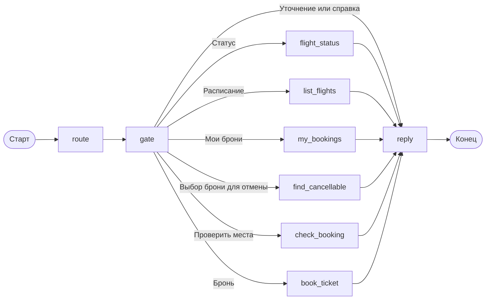

# Консольный авиаагент

Учебный агент на LangGraph показывает расписание и статус рейса, отвечает на приветствия и оформляет демобронь. Расписание вымышленное, оплата и подключение к системам авиакомпаний отсутствуют.

## Запуск в Windows

Запустите Docker Desktop в режиме Linux containers и локальную Ollama. В PowerShell из папки проекта выполните:

```powershell
ollama pull qwen3.5:4b-q4_K_M
docker compose run --rm --build agent
```

Compose запускает PostgreSQL в сервисе `db` и открывает терминал сервиса `agent`. Модель работает через Ollama на Windows, поэтому доступ к видеокарте настраивает Ollama. Проверить размещение модели можно командой `ollama ps`. [Сеть Docker Desktop](https://docs.docker.com/desktop/features/networking/networking-how-tos/)

Адрес Ollama по умолчанию — `http://host.docker.internal:11434`. Если Ollama доступна по другому адресу, задайте `OLLAMA_URL` перед запуском. Для сервера, который требует токен доступа, задайте `OLLAMA_API_KEY`. Для остановки контейнеров выполните `docker compose down`. Тома сохраняют аккаунты, рейсы, демоброни и ключ для проверки дубликатов.

## Сценарий для защиты

1. Введите `/register demo`, придумайте пароль от 8 символов и укажите вымышленное имя в формате «Фамилия Имя». Войдите через `/login demo`.
2. Включите `/trace`. Введите «Рейс SU123 вылетает вовремя?». Первый вызов `flight_status` покажет две даты.
3. Введите `2027-06-12`. Агент вызовет `flight_status` с номером и датой и сообщит о задержке.
4. Введите «Забронируй этот рейс». Агент вспомнит рейс, проверит места и покажет цены с багажом и без него в рублях. Имя пассажира берётся из профиля.
5. Введите `/passport`, подтвердите пароль аккаунта и введите вымышленный паспорт `9900 123456`. Оба поля вводятся скрыто. Агент покажет идентификатор демоброни после записи в PostgreSQL. Команда `/bookings` или запрос «покажи мои брони» покажут записи текущего аккаунта, включая ранее созданные.
6. Введите `/graph`, чтобы получить Mermaid-схему прямо в терминале. Остальные команды доступны через `/help`.

На «какие рейсы есть» агент выводит полное расписание. Предыдущий ввод можно вернуть стрелкой ↑. История хранится в памяти консоли до выхода из аккаунта, скрытые пароли и паспорта в неё не попадают. На «привет» и «как дела» отвечает Qwen без вызова инструмента.

Обычные сообщения обрабатывает Qwen через Ollama с включённым режимом размышления. Запрос к модели содержит цель текущего диалога и последний список вариантов, если они есть. Служебные команды и ввод секретов обрабатывает приложение. [Режим размышления Ollama](https://docs.ollama.com/capabilities/thinking)

Агент запоминает последний список рейсов. Например, после «мне нужно в Питер» можно сказать «давай за 7к» и выбрать SU125 с багажом. Запрос «какой самый дешёвый?» показывает вариант, а «возьми второй» уточняет тариф, если у второго рейса их несколько. Выбранный по списку тариф сохраняется в демоброни после подтверждения через `/passport`.

После «го в Питер» запрос «купи 4» выбирает рейс под номером 4 в списке. Если у рейса два тарифа, ответьте «с багажом», «без багажа» или выберите номер тарифа, затем подтвердите демобронь через `/passport`.

В том же списке фраза «забронируй два билета на 15 июня» выбирает рейс по дате и проверяет наличие двух мест. После выбора тарифа `/passport` запрашивает пароль и данные всех пассажиров. Для первого пассажира используется имя из аккаунта. Агент оформляет все билеты одной транзакцией и возвращает отдельный номер на каждого пассажира.

Чтобы отменить демобронь, напишите «отмени мою бронь S7203» или введите `/cancel ID`. При нескольких совпадениях агент попросит ID. Введите `/cancel` без аргументов и подтвердите пароль. Отменённая бронь остаётся в истории, место возвращается в расписание.

Для примера с альтернативами попросите «Забронируй у Аэрофлота из Москвы в Санкт-Петербург на 2027-06-11». Агент упорядочит варианты по абсолютному расстоянию до даты, при равенстве поставит рейсы после запрошенной даты первыми, затем по времени вылета и номеру рейса. Паспорт запрашивается после выбора доступного рейса и проверки пароля.

## Состояние и вызовы



`route` получает от Qwen структурированное намерение и поля рейса. `gate` дополняет их данными текущего диалога и проверяет полноту. За сообщение выполняется до одного вызова инструмента, предел LangGraph — 8 шагов. Инструмент возвращает поля `status`, `message`, `missing_fields` и `alternatives`. Ответ строится из этого результата. [Структурированный вывод Ollama](https://docs.ollama.com/capabilities/structured-outputs)

Например, после успешного поиска `selected = {number: SU123, flight_date: 2027-06-12}`. После фразы «Забронируй этот рейс» значения переходят в `draft`, `pending` становится `book`. Если места есть, `missing_fields` содержит `password` и `passport`. Между сообщениями LangGraph сохраняет выбранный рейс, черновик и ID аккаунта, подтвердившего выбор рейса. При выходе или по `/reset` эта память очищается. [Память LangGraph](https://docs.langchain.com/oss/python/langgraph/persistence)

Пароли хранятся с солью и scrypt. Команда `/passport` повторно проверяет места, сверяет пароль с хешем текущего аккаунта и только затем запрашивает паспорт. Для проверки дубликатов в PostgreSQL сохраняется HMAC паспорта. Транзакция блокирует строку рейса, проверяет остаток мест и уменьшает его вместе с записью брони. Цены демонстрационные и показываются для справки.

## Проверка

```powershell
docker compose run --rm agent python -m tests.run
docker compose run --rm agent python -m tests.run --live
```

Первый запуск использует сценарные решения модели и проверяет граф и реальную БД. Второй использует Qwen через Ollama. Тесты изолированы в отдельной схеме PostgreSQL. Для каждого шага выводится JSON со сценарием, ожидаемыми и фактическими инструментом и параметрами, ответом и отметкой о прохождении. Последняя строка содержит метрики и отдельную сводку по критичным сценариям.

В отчёте также проверяется, что неверный пароль останавливает запрос до ввода паспорта, а другой аккаунт не видит чужую бронь.

| Фича | Критерий | Проверка |
| --- | --- | --- |
| Статус | Найден, задержан, не найден или требуется уточнить данные | SU123 на обе даты, SU123 без даты, запрос без номера, ZZ999 |
| Расписание и диалог | Выведены все рейсы, разговорный ответ пришёл от Qwen, стрелка ↑ возвращает ввод | Три запроса расписания, приветствие, короткая реплика, проверка клавиш |
| Память | Агент использует выбранный ранее рейс | Статус → «Забронируй этот рейс» → паспорт |
| Бронь | Запись создаётся один раз, остаток мест обновляется атомарно | Успешная, повторная и конкурентная бронь |
| Мои брони | Аккаунт видит только свои записи | Запрос после бронирования и проверка с другим аккаунтом |
| Отмена | Требует подтверждения владельца и возвращает место один раз | Выбор брони, неверный пароль, отмена и повторное бронирование |
| Тарифы | Каждый рейс показывает две цены | Вывод расписания с ценами без багажа и с багажом |
| Ссылки на список | Цена, порядок и тариф относятся к последним показанным рейсам | Поиск рейсов в Петербург, запрос самого дешёвого, выбор второго и демобронь за 7 000 ₽ |
| Валидация | Невалидный или отсутствующий паспорт не создаёт бронь | Некорректный паспорт и попытка обойти правила |
| Расписание | Отдельные ответы для отсутствия мест, маршрута и даты | S7201, Победа Москва–Казань, Аэрофлот Москва–Санкт-Петербург 11 июня |
| Учётные записи | Вход требует верный пароль и логин уникален | Регистрация, повторный логин при регистрации, неверный и верный пароль |
